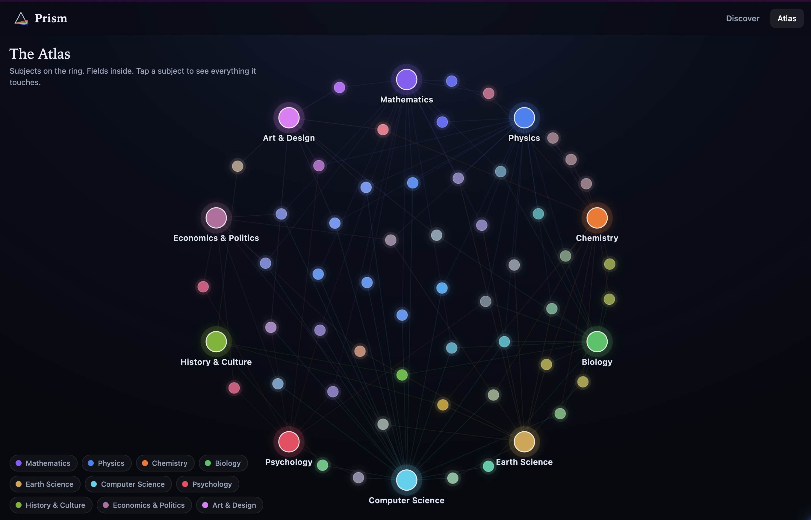

# Prism



> **An academic atlas of some interdisciplinary fields I wish I had back in high school.**

School shows you ten subjects. It hides a thousand fields. Exciting modern fields are often combinations of the core subjects you already know. Prism helps you see how they connect.

This is a lightweight Python + Web application served locally.

---

## Getting Started

### Prerequisites
Make sure you have [uv](https://github.com/astral-sh/uv) installed.

### Run the App Locally
To start the local FastAPI server and serve the web app:

```bash
uv run main.py
```

Then open your browser to:
👉 **[http://127.0.0.1:8000](http://127.0.0.1:8000)**

*(Note: You can also just double-click **[prism.html](prism.html)** directly in your Finder to open and run the app offline!)*

---

## Project Structure

```
.
├── main.py             # FastAPI backend to serve the files
├── prism.html          # Clean HTML5 markup
├── prism.css           # Modular stylesheet and custom scrollbars
├── prism.js            # Synthesizers, physics, and viewport logic
└── prism-design-brief.md # Original spec & design specs
```

---

## Behind the Scenes

Built from scratch with zero framework overhead, using direct DOM layout and custom math.

- **GPU-Accelerated Viewport**: Viewport zoom/pan operations are calculated in JS but executed using hardware-accelerated CSS `translate3d` and `scale` on a single SVG `<g>` viewport group. This keeps the rendering smooth and offloads drawing to the GPU compositor.
- **Sleep-State Physics Loop**: The animation loop (`requestAnimationFrame`) puts itself to sleep when idle (no mouse movement, no viewport panning, and all nodes settled), dropping CPU usage to **0%** and completely resolving audio cracking/delays.
- **Pre-linked Lookups**: Mapped graph nodes to line edges at load time, dropping edge updates from `O(E * N)` linear lookups to direct `O(1)` access per frame.
- **Dynamic Filter-Bypassing**: Heavy SVG Gaussian blur filters are bypassed during active movements to keep the frame rate locked at a clean 60fps.
- **Proportional Shifts**: Automatically shifts and centers nodes on window resizes and mobile portrait drawer openings, keeping active elements visible and clear of overlays.
- **Damped Hover Legibility**: Dimmed nodes fade smoothly to `0.75` opacity and display their labels on hover, ensuring high legibility.
- **Interactive Cursor physics**: Uses GPU `translate3d` tracking and custom, detune-glow shadows mapped via CSS transition exclusions.
- **Minimalist Scrollbars**: Implemented Antigravity-style overlay scrollbars (`6px` width, transparent track) across all WebKit and Firefox browsers.
